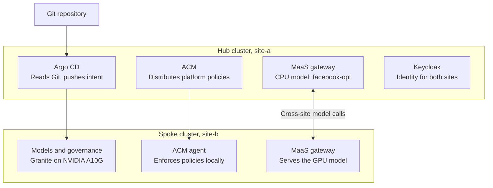

# MaaS Platform Provisioning using Gitops and ACM automation

> **Work in progress.**

## Design

[osac-gitops-acm-design.md](osac-gitops-acm-design.md)

## Reference Implementation

[install.md](install.md)

## Models and governance

The `site-a` and `site-b` implementation of models and governance is only to prove out the provisioning.

## Topology of Reference implementation

