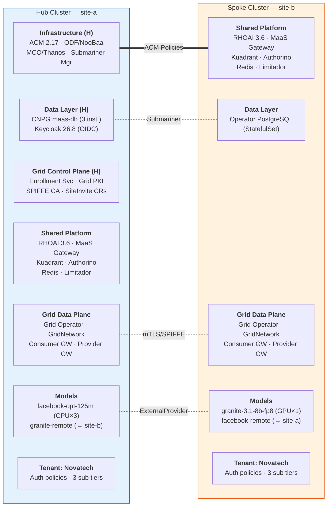
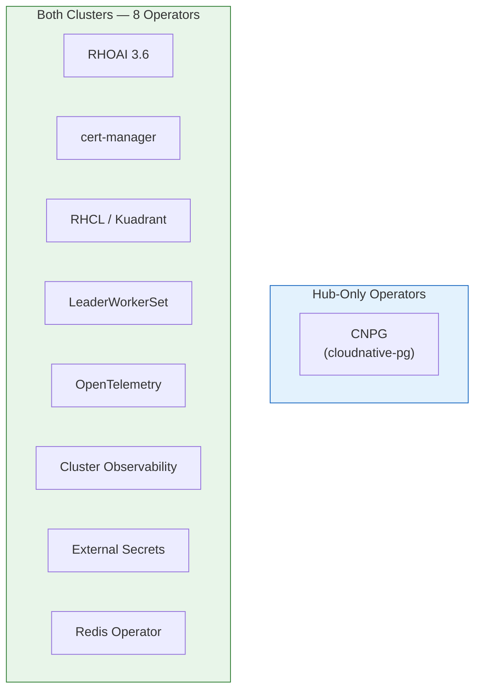
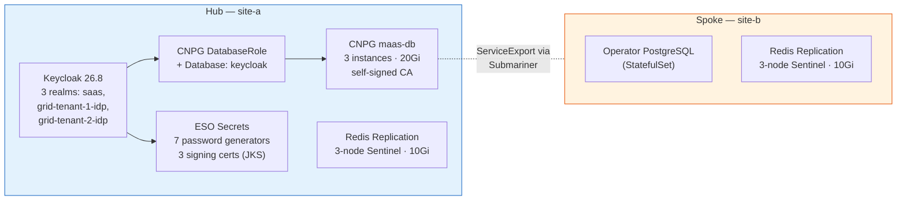
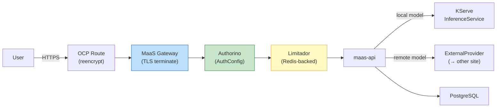
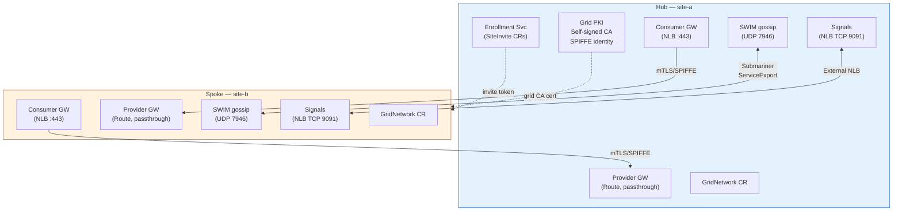
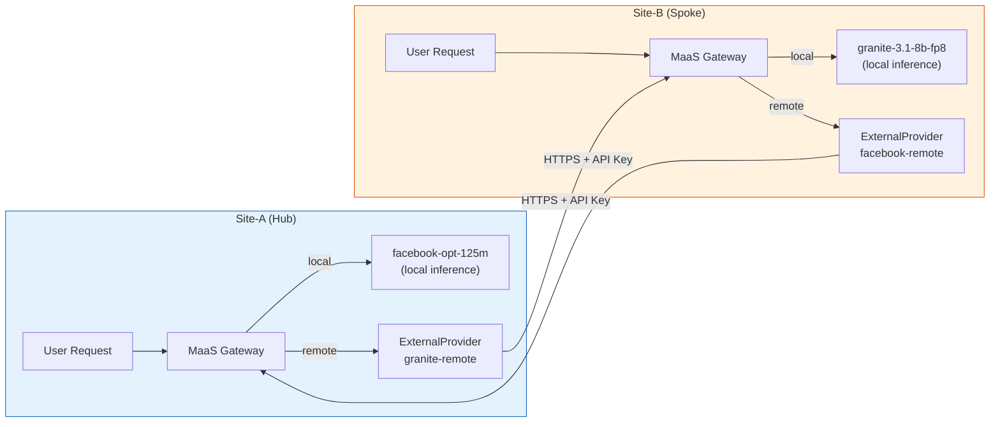
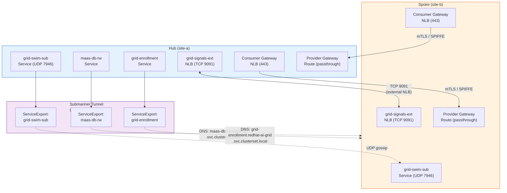
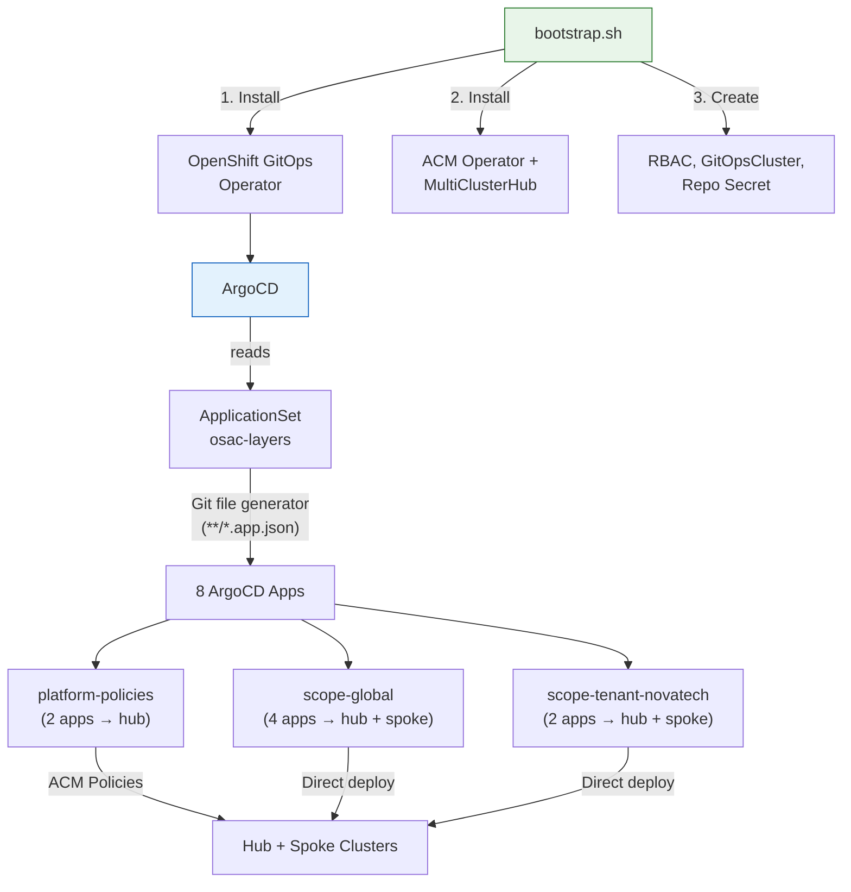

# OSAC Deployment Topology

This document maps every component deployed by the osac-gitops repository across
the hub cluster (site-a / `local-cluster`) and the spoke cluster (site-b).
Components are delivered via **26 ACM policies** and **8 ArgoCD applications**
generated from a single ApplicationSet.

---

## High-Level Architecture

Overview of component groups on each cluster. Hub-only components are marked with **(H)**.

### Operators Installed on Each Cluster

### Data and Identity Layer

### MaaS Request Path (per cluster)

### AI Grid Mesh

---

## Hub-Only Components

These are deployed **only on the hub** via the `osac-hub-only` placement (9 policies).

| Policy | Component | Key Resources | Namespace |
|--------|-----------|---------------|-----------|
| **00** `osac-hub-secret-mirror` | Secret Mirrors | CNPG replication/CA, grid SWIM key, invite tokens, hub service-CA, grid CA → `osac-platform` | `osac-platform` |
| **01** `osac-cnpg-operator` | CNPG Operator | Subscription `cloudnative-pg` (stable-v1) | `cnpg-system` |
| **04** `osac-database-hub` | CNPG PostgreSQL | Cluster `maas-db` (3 instances, 20Gi), ServiceExport `maas-db-rw`, Secret `maas-db-config` | `maas-db`, `redhat-ai-gateway-infra` |
| **09** `osac-keycloak` | Keycloak 26.8 | DatabaseRole, Database, ESO secrets (7 password generators), cert-manager signing keys (3 JKS certs), realm import (3 realms: saas, grid-tenant-1-idp, grid-tenant-2-idp), Deployment, Service, Route, ConfigMap `keycloak-public-url` | `maas-db` |
| **12** `osac-grid-enrollment` | Grid Enrollment | Deployment, PVC (1Gi), Service, Route, ServiceExport, NetworkPolicy, RBAC, SiteInvite `site-b`, GridSite + InferenceProvider (peer declarations) | `redhat-ai-grid`, `grid-enrollment-invites` |
| **15** `osac-odf` | ODF (NooBaa) | Subscription `odf-operator` (stable-4.22), StorageCluster `ocs-storagecluster` (standalone MCG) | `openshift-storage` |
| **16** `osac-acm` | ACM 2.17 | Subscription, MultiClusterHub, MCO (Thanos with OBC storage), Thanos bridge Job, policy addon ClusterManagementAddOns (governance-policy-framework, config-policy-controller) | `open-cluster-management`, `open-cluster-management-observability` |
| **17** `osac-submariner-addon` | Submariner Addons | ManagedClusterAddOn + SubmarinerConfig per site (AWS creds, 2 gateways) | Per managed cluster NS |
| **20** `osac-grid-pki` | Grid PKI | Self-signed CA (ECDSA P-256, 10y), CA Issuer, site identity cert (SPIFFE URI), enrollment TLS cert, SWIM key generator (ESO) | `redhat-ai-grid` |

---

## All-Clusters Components

These are deployed on **both hub and spoke** via the `osac-platform-sites` placement (15 policies).

### Operators (Policy 01)

| Operator | Subscription | Channel | Namespace |
|----------|-------------|---------|-----------|
| cert-manager | `openshift-cert-manager-operator` | stable-v1.18 | `cert-manager-operator` |
| RHCL (Kuadrant) | `rhcl-operator` | stable | `kuadrant-system` |
| LeaderWorkerSet | `leader-worker-set` | stable-v1.0 | `openshift-lws-operator` |
| RHOAI | `rhods-operator` | per-site params | `redhat-ods-operator` |
| OpenTelemetry | `opentelemetry-product` | stable | `openshift-opentelemetry-operator` |
| Cluster Observability | `cluster-observability-operator` | stable | `openshift-cluster-observability-operator` |
| External Secrets | `openshift-external-secrets-operator` | stable-v1 | `external-secrets-operator` |
| Redis | `redis-operator` | stable (community) | `limitador-redis` |

### Prerequisites (Policy 00)

| Resource | Purpose |
|----------|---------|
| ImageDigestMirrorSet `quay-registry` | RHOAI image mirrors (rhoai, rhaii, rhaii-early-access, rhaii-fast) |
| CatalogSource `rhoai-catalog-dev` | RHOAI 3.6 nightly FBC catalog |
| Secret `rhoai-catalog-pull-secret` | Quay pull secret for marketplace |
| Secret `pull-secret` (merge) | Global pull-secret with quay.io/rhoai auth |
| ServiceAccount `default` (marketplace) | Links pull-secret for OLM bundle unpack |

### Platform Config (Policy 02)

| Resource | Type | Key Settings |
|----------|------|-------------|
| `cluster-monitoring-config` | ConfigMap | `enableUserWorkload: true` |
| `default-dsci` | DSCInitialization | `monitoring: Removed`, trustedCABundle with CNPG CA, applicationsNamespace: `redhat-ods-applications` |
| `default-dsc` | DataScienceCluster | **Managed:** dashboard, kserve, aigateway (aiGrid + modelsAsAService) — **Removed:** ray, trainer, trainingoperator, trustyai, workbenches, modelregistry, ogx, aipipelines, feastoperator, kueue |
| `odh-dashboard-config` | OdhDashboardConfig | modelAsService: true |

### Gateways & Auth (Policies 03, 07)

| Resource | Type | Details |
|----------|------|---------|
| `maas-gateway-class` | GatewayClass | controllerName: openshift.io/gateway-controller/v1 |
| `openshift-ai-inference-class` | GatewayClass | controllerName: openshift.io/gateway-controller/v1 |
| `maas-default-gateway` | Gateway | HTTPS listeners (ext + internal), TLS terminate, Kuadrant-labeled, ClusterIP via `gw-options` ConfigMap |
| `openshift-ai-inference` | Gateway | HTTP + HTTPS listeners |
| `maas-gateway-route` | Route | Reencrypt TLS, service-CA destination cert |
| `kuadrant` | Kuadrant | observability disabled |
| `authorino` | Authorino | cluster-wide, listener TLS enabled, certSecretRef: `authorino-server-cert` |
| Inference gateway Service | annotation | serving-cert for `openshift-ai-inference-tls` |
| Authorino Service | annotation | serving-cert for `authorino-server-cert`, gRPC port 50051 |
| Authorino Deployment | env patch | `WATCH_NAMESPACE=""` (cluster-wide) |

### Database Namespaces (Policy 04)

| Namespace | Purpose |
|-----------|---------|
| `maas-db` | Database tier (CNPG on hub, Keycloak on hub) |
| `redhat-ai-gateway-infra` | MaaS API infrastructure |
| `redhat-ods-applications` | RHOAI applications (dashboard, maas-api, etc.) |

### Default Tenant (Policy 05)

| Resource | Type | Namespace |
|----------|------|-----------|
| `models-as-a-service` | Namespace | (labeled `osac.io/governance`) |
| `ai-tenants` | Namespace | |
| `ai-grid-internal-models` | Namespace | (labeled `grid.opendatahub.io/allowed`, `osac.io/models`) |
| `redhat-ai-grid` | Namespace | |
| `grid-model-client` | ServiceAccount | `redhat-ai-grid` |
| `grid-model-client-token` | Secret (SA token) | `redhat-ai-grid` |
| `models-as-a-service` | AITenant | `ai-tenants` (OIDC → Keycloak saas realm) |
| `default-tenant` | MaasTenantConfig | `models-as-a-service` (metrics telemetry enabled) |

### Rate Limiting — Redis + Limitador (Policy 10)

| Resource | Details |
|----------|---------|
| RedisReplication `limitador-redis` | 3-node Sentinel cluster, 10Gi PVC/node, RHEL9 Redis 7 |
| Secret `limitador-redis` | Redis connection URL in `kuadrant-system` |
| Limitador `limitador` | Redis-backed, in `kuadrant-system` |
| NetworkPolicy `limitador-redis-isolation` | Restricts to intra-namespace + kuadrant-system limitador pods |

### AI Grid Network (Policies 11, 13, 18, 19)

| Resource | Type | Purpose |
|----------|------|---------|
| Grid operator Deployment | patch | Site name, signals advertise addr, membership source |
| Grid operator ConfigMap | config | Site name, signer endpoint, invite secret ref |
| GridNetwork | CR | Grid ID, signal transport (poll), peer trust (SPIFFE), TLS identity/CA |
| GridSite (local + peer) | CR | Gateway endpoints with mTLS |
| `grid-swim-sub` Service | ClusterIP | SWIM UDP 7946 + Submariner ServiceExport |
| `grid-signals-ext` Service | LoadBalancer/NLB | Signals TCP 9091 |
| `grid-swim-key` Secret | distribution | Hub SWIM key → all clusters |
| Consumer gateway Deployment | praxis | mTLS with grid identity, LoadBalancer port 443 |
| Provider gateway Deployment | praxis | SPIFFE peer trust, passthrough Route |
| NetworkPolicies | 4 total | Grid metrics scraping, gateway backend, consumer/provider ingress |

### Hardware Profiles (Policy 06)

Dynamic `HardwareProfile` CRs in `redhat-ods-applications` generated from site params JSON (CPU, memory, accelerator specs with node selectors and tolerations).

### Observability (Policy 14)

| Resource | Purpose |
|----------|---------|
| ScrapeConfig `grid-metrics` | Grid gateway metrics (port 9443) |
| ScrapeConfig `grid-operator-metrics` | Grid operator (port 9090) |
| ScrapeConfig `epp-metrics` | EPP service (port 9090) |
| ScrapeConfig `rhai-metrics` | data-science-collector (port 8890) via ACM |
| ScrapeConfig `vllm-metrics` | vLLM via UWM federate (port 9092) via ACM |
| RBAC | ServiceAccounts + tokens + ClusterRoleBindings for metrics readers |
| NetworkPolicies | Allow ACM agent-addon to scrape RHAI, grid, and pool metrics |

### Submariner (Policy 17)

| Resource | Details |
|----------|---------|
| Namespace `default-broker` | Submariner broker namespace |
| Broker `submariner-broker` | GlobalNet enabled, CIDR 242.0.0.0/8 |
| ConfigMap `submariner-globalnet-info` | GlobalNet configuration |
| Node labels | `submariner.io/gateway: "true"` on all workers |

---

## Per-Site Model Deployments

Delivered by 4 ArgoCD applications from the `scope-global` AppProject.

### Site-A (Hub) — `ai-grid-internal-models`

| Model | Type | Spec |
|-------|------|------|
| `facebook-opt-125m` | LLMInferenceService | CPU-only, 3 replicas, routed via `maas-default-gateway` |
| `facebook-opt-125m` | MaaSModelRef | Registered in MaaS catalog |

### Site-A (Hub) — `external-models`

| Resource | Type | Details |
|----------|------|---------|
| `granite-remote-provider` | ExternalProvider | Points to site-b gateway, apikey auth via `granite-remote-key` |
| `granite-remote` | ExternalModel | Routes requests to Granite on site-b |
| `granite-remote` | MaaSModelRef | Catalog registration |
| `osac-provider-recheck` | CronJob | Wakes providers stuck on SecretNotFound (every 1m) |

### Site-B (Spoke) — `ai-grid-internal-models`

| Model | Type | Spec |
|-------|------|------|
| `granite-3-1-8b-fp8` | LLMInferenceService | GPU (NVIDIA A10G), granite-3.1-8b-instruct-fp8 from OCI, 1 replica |
| `granite-3-1-8b-fp8` | MaaSModelRef | Registered in MaaS catalog |

### Site-B (Spoke) — `external-models`

| Resource | Type | Details |
|----------|------|---------|
| `facebook-remote-provider` | ExternalProvider | Points to site-a gateway, apikey auth via `facebook-remote-key` |
| `facebook-remote` | ExternalModel | Routes requests to facebook-opt-125m on site-a |
| `facebook-remote` | MaaSModelRef | Catalog registration |
| `osac-provider-recheck` | CronJob | Wakes providers stuck on SecretNotFound (every 1m) |

### Per-Site Secret Distribution (Policy 08)

| Policy | Target | Secret |
|--------|--------|--------|
| `osac-granite-consumer-secrets` | hub (local-cluster) | `granite-remote-key` in `external-models` |
| `osac-facebook-consumer-secrets` | spoke (site-b) | `facebook-remote-key` in `external-models` |

---

## Cross-Cluster Model Routing

---

## Cross-Cluster Connectivity

### Submariner ServiceExports

| Service | Namespace | Cross-Cluster DNS |
|---------|-----------|-------------------|
| `maas-db-rw` | `maas-db` | `maas-db-rw.maas-db.svc.clusterset.local` |
| `grid-enrollment` | `redhat-ai-grid` | `grid-enrollment.redhat-ai-grid.svc.clusterset.local` |
| `grid-swim-sub` | `redhat-ai-grid` | `grid-swim-sub.redhat-ai-grid.svc.clusterset.local` |

### Grid mTLS Identity

Each site has a SPIFFE-based identity certificate (ECDSA P-256) signed by the grid CA.
Consumer gateways authenticate to provider gateways using mutual TLS with these identities.

---

## Tenant Governance

Delivered by 2 ArgoCD applications from the `scope-tenant-novatech` AppProject.

### Novatech Tenant — Site-A (Hub)

| Resource | Type | Details |
|----------|------|---------|
| `novatech-model-access` | MaaSAuthPolicy | Grants free/premium/enterprise access to `facebook-opt-125m` + `granite-remote` |
| `novatech-free-subscription` | MaaSSubscription | 100 tokens/min, priority 10 |
| `novatech-premium-subscription` | MaaSSubscription | 50,000 tokens/min, priority 20 |
| `novatech-enterprise-subscription` | MaaSSubscription | 100,000 tokens/min, priority 30 |
| `facebook-cross-cluster-access` | MaaSAuthPolicy | `system:authenticated` → `facebook-opt-125m` (grid consumers from site-b) |
| `facebook-cross-cluster-sub` | MaaSSubscription | 999,999,999 tokens/min, priority 1 (effectively unlimited for grid) |

### Novatech Tenant — Site-B (Spoke)

| Resource | Type | Details |
|----------|------|---------|
| `novatech-model-access` | MaaSAuthPolicy | Grants free/premium/enterprise access to `granite-3-1-8b-fp8` + `facebook-remote` |
| `novatech-free-subscription` | MaaSSubscription | 100 tokens/min, priority 10 |
| `novatech-premium-subscription` | MaaSSubscription | 50,000 tokens/min, priority 20 |
| `novatech-enterprise-subscription` | MaaSSubscription | 100,000 tokens/min, priority 30 |
| `granite-cross-cluster-access` | MaaSAuthPolicy | `system:authenticated` → `granite-3-1-8b-fp8` (grid consumers from site-a) |
| `granite-cross-cluster-sub` | MaaSSubscription | 999,999,999 tokens/min, priority 1 (effectively unlimited for grid) |

---

## GitOps Delivery Mechanism

### ApplicationSet

| Field | Value |
|-------|-------|
| Name | `osac-layers` |
| Generator | Git file: `**/*.app.json` |
| Sync policy | Automated (prune + selfHeal), ServerSideApply |
| Namespace | `openshift-gitops` |

### ArgoCD AppProjects

| Project | Clusters | Namespaces | Resource Types |
|---------|----------|------------|----------------|
| `platform-policies` | hub only | `osac-platform`, `openshift-gitops` | Policy, PlacementBinding, Placement, ManagedClusterSetBinding, ConfigMap, Namespace |
| `scope-global` | all (`*`) | `ai-grid-internal-models`, `models-as-a-service`, `external-models` | LLMInferenceService, MaaSModelRef, ExternalProvider, ExternalModel, SA, Role, RoleBinding, CronJob, Namespace |
| `scope-tenant-novatech` | all (`*`) | `models-as-a-service` | MaaSSubscription, MaaSAuthPolicy |

### Generated Applications

| App Name | Source Path | Target | Project |
|----------|------------|--------|---------|
| `global-hub-platform` | `hub/platform` | hub / `openshift-gitops` | platform-policies |
| `global-hub-platform-sites` | `hub/platform-sites` | hub / `openshift-gitops` | platform-policies |
| `global-site-a-models` | `global/sites/site-a/models` | hub / `ai-grid-internal-models` | scope-global |
| `global-site-a-external-models` | `global/sites/site-a/external-models` | hub / `external-models` | scope-global |
| `global-site-b-models` | `global/sites/site-b/models` | spoke / `ai-grid-internal-models` | scope-global |
| `global-site-b-external-models` | `global/sites/site-b/external-models` | spoke / `external-models` | scope-global |
| `tenant-novatech-site-a-governance` | `tenants/novatech/sites/site-a/governance` | hub / `models-as-a-service` | scope-tenant-novatech |
| `tenant-novatech-site-b-governance` | `tenants/novatech/sites/site-b/governance` | spoke / `models-as-a-service` | scope-tenant-novatech |

---

## Policy Index

All 26 ACM policies and their cluster targeting.

| # | Policy Name | Placement | Target |
|---|-------------|-----------|--------|
| 00 | `osac-hub-secret-mirror` | `osac-hub-only` | Hub |
| 00 | `osac-prerequisites` | `osac-platform-sites` | All |
| 01 | `osac-cnpg-operator` | `osac-hub-only` | Hub |
| 01 | `osac-operators` | `osac-platform-sites` | All |
| 02 | `osac-platform-config` | `osac-platform-sites` | All |
| 03 | `osac-gateway` | `osac-platform-sites` | All |
| 04 | `osac-database` | `osac-platform-sites` | All |
| 04 | `osac-database-hub` | `osac-hub-only` | Hub |
| 05 | `osac-default-tenant` | `osac-platform-sites` | All |
| 06 | `osac-hardware-profiles` | `osac-platform-sites` | All |
| 07 | `osac-service-tls` | `osac-platform-sites` | All |
| 08 | `osac-granite-consumer-secrets` | `osac-granite-consumers` | Hub |
| 08 | `osac-facebook-consumer-secrets` | `osac-facebook-consumers` | Spoke |
| 09 | `osac-keycloak` | `osac-hub-only` | Hub |
| 10 | `osac-redis-limitador` | `osac-platform-sites` | All |
| 11 | `osac-grid-network-policies` | `osac-platform-sites` | All |
| 12 | `osac-grid-enrollment` | `osac-hub-only` | Hub |
| 13 | `osac-grid-network` | `osac-platform-sites` | All |
| 14 | `osac-observability` | `osac-platform-sites` | All |
| 15 | `osac-odf` | `osac-hub-only` | Hub |
| 16 | `osac-acm` | `osac-hub-only` | Hub |
| 17 | `osac-submariner` | `osac-platform-sites` | All |
| 17 | `osac-submariner-addon` | `osac-hub-only` | Hub |
| 18 | `osac-grid-swim-key` | `osac-platform-sites` | All |
| 19 | `osac-grid-gateway` | `osac-platform-sites` | All |
| 20 | `osac-grid-pki` | `osac-hub-only` | Hub |

---

## Namespace Map

| Namespace | Hub | Spoke | Primary Components |
|-----------|-----|-------|--------------------|
| `openshift-gitops` | x | | ArgoCD, ApplicationSet |
| `osac-platform` | x | | ACM policies, placements, site params |
| `open-cluster-management` | x | | ACM operator, MultiClusterHub |
| `open-cluster-management-observability` | x | | MCO, Thanos |
| `openshift-storage` | x | | ODF (NooBaa MCG) |
| `cnpg-system` | x | | CNPG operator |
| `maas-db` | x | x | CNPG cluster (hub), Keycloak (hub), namespaces (both) |
| `redhat-ai-gateway-infra` | x | x | maas-api, maas-db-config secret |
| `redhat-ods-operator` | x | x | RHOAI operator |
| `redhat-ods-applications` | x | x | RHOAI dashboard, maas-api, maas-ui, HardwareProfiles |
| `redhat-ods-monitoring` | x | x | data-science-collector (OTel) |
| `cert-manager-operator` | x | x | cert-manager operator |
| `kuadrant-system` | x | x | Kuadrant, Authorino, Limitador |
| `openshift-ingress` | x | x | MaaS Gateway, Inference Gateway, Routes |
| `openshift-lws-operator` | x | x | LeaderWorkerSet operator |
| `openshift-opentelemetry-operator` | x | x | OpenTelemetry operator |
| `openshift-cluster-observability-operator` | x | x | Cluster Observability operator |
| `external-secrets-operator` | x | x | External Secrets operator |
| `limitador-redis` | x | x | Redis operator, RedisReplication |
| `models-as-a-service` | x | x | MaasTenantConfig, tenant governance |
| `ai-tenants` | x | x | AITenant |
| `ai-grid-internal-models` | x | x | LLMInferenceService, MaaSModelRef |
| `redhat-ai-grid` | x | x | Grid operator, gateways, enrollment (hub), PKI (hub), SWIM |
| `external-models` | x | x | ExternalProvider, ExternalModel, API key secrets |
| `grid-enrollment-invites` | x | | Grid enrollment invite tokens |
| `default-broker` | x | x | Submariner broker |
| `openshift-monitoring` | x | x | cluster-monitoring-config (user workload) |
| `openshift-marketplace` | x | x | FBC catalog, pull secrets |
