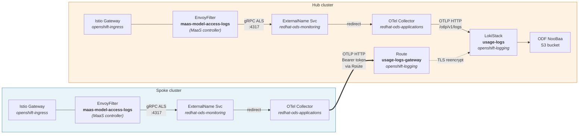
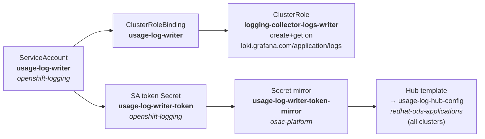

# Federated Usage-Log Aggregation

| Field   | Value |
|---------|-------|
| Status  | **Implemented** |
| Branch  | `feature/rhoai-3.6` |
| Date    | 2026-10-29 |

## Overview

RHOAI 3.6 includes a built-in usage-log pipeline that meters every
inference request: token counts, model, subscription, user identity,
cost centre, and response classification.  The pipeline is designed
around **Loki** (not Prometheus) — dashboards use LogQL `unwrap` to
aggregate numeric fields stored as structured metadata.

In our deployment DSCI monitoring is **Removed** (blocked by an
upstream OTel/cert-manager bug).  Because the RHOAI observability
controller (`odh-observability`) only deploys logging components when
monitoring is *Managed*, we deploy the entire pipeline ourselves via
ACM policies — consistent with the existing GitOps pattern.

The architecture centralises all usage logs on the **hub** LokiStack.
Spoke clusters push directly via OTLP HTTP over an OpenShift Route,
mirroring how MCO federates metrics to the hub Thanos.

## Architecture



### Component inventory

| Component | Kind | Namespace | Clusters | Policy file |
|-----------|------|-----------|----------|-------------|
| Loki Operator | Subscription | `openshift-logging` | hub | `01-loki-operator-policy.yaml` |
| ObjectBucketClaim `loki-usage-logs` | OBC | `openshift-logging` | hub | `21-logging-policy.yaml` |
| Bridge Job `loki-bridge` | Job | `openshift-logging` | hub | `21-logging-policy.yaml` |
| LokiStack `usage-logs` | LokiStack | `openshift-logging` | hub | `21-logging-policy.yaml` |
| Route `usage-logs-gateway` | Route | `openshift-logging` | hub | `21-logging-policy.yaml` |
| Writer SA + RBAC | SA, ClusterRole, CRB | `openshift-logging` | hub | `21-logging-policy.yaml` |
| Token mirror `usage-log-writer-token-mirror` | Secret | `osac-platform` | hub | `00-hub-secret-mirror-policy.yaml` |
| Hub-config Secret `usage-log-hub-config` | Secret | `redhat-ods-applications` | all | `14-observability-policy.yaml` |
| OTel Collector `usage-logs` | OpenTelemetryCollector | `redhat-ods-applications` | all | `14-observability-policy.yaml` |
| NetworkPolicy (gateway → collector) | NetworkPolicy | `redhat-ods-applications` | all | `14-observability-policy.yaml` |
| ExternalName redirect | Service | `redhat-ods-monitoring` | all | `14-observability-policy.yaml` |
| EnvoyFilter `maas-model-access-logs` | EnvoyFilter | `openshift-ingress` | all | *MaaS controller (not git-managed)* |

## Data Flow

### 1. EnvoyFilter capture (MaaS controller)

The MaaS controller deploys `maas-model-access-logs` on Istio gateway
pods (`gateway.networking.k8s.io/gateway-name=maas-default-gateway` in
`openshift-ingress`).  It fires on:

```
CEL: request.method == 'POST'
  && (request.path.endsWith('/v1/chat/completions')
   || request.path.endsWith('/v1/completions')
   || request.path.endsWith('/v1/embeddings'))
```

The filter chain extracts per-request attributes using:

| Technique | What it captures |
|-----------|-----------------|
| `header_to_metadata` | `x-model`, `x-subscription`, `x-user-id`, `x-organization-id`, `x-cost-center`, `x-key-name`, `x-groups` |
| `json_to_metadata` | `usage.prompt_tokens`, `usage.completion_tokens`, `usage.total_tokens` from JSON response body |
| Lua script | Token counts from SSE `data: {...}` streams (accumulates `[DONE]` chunk) |
| CEL filter | `response_type` classification (`hit` / `stream` / `miss`) |

These are emitted as a structured access-log entry to `otel_als_cluster`
at `data-science-usage-logs-collector.redhat-ods-monitoring.svc:4317`
(gRPC ALS).

### 2. ExternalName Service bridge

Because DSCI monitoring is Removed, the service the EnvoyFilter targets
does not exist.  An ExternalName Service in `redhat-ods-monitoring`
redirects to our OTel Collector without modifying the controller-managed
EnvoyFilter:

```yaml
apiVersion: v1
kind: Service
metadata:
  name: data-science-usage-logs-collector
  namespace: redhat-ods-monitoring
spec:
  type: ExternalName
  externalName: usage-logs-collector.redhat-ods-applications.svc.cluster.local
  ports:
    - port: 4317
      protocol: TCP
```

### 3. OTel Collector processing

The collector runs in `redhat-ods-applications` on every cluster:

```yaml
receivers:
  otlp:
    protocols:
      grpc:
        endpoint: 0.0.0.0:4317
processors:
  memory_limiter:
    limit_mib: 256
    spike_limit_mib: 64
    check_interval: 5s
  resource:
    attributes:
      - key: service.name
        value: models-as-a-service
        action: upsert
      - key: log_type
        value: application
        action: upsert
      - key: openshift.log.source
        value: container
        action: upsert
  groupbyattrs:
    keys: [subscription, model, response_type]
  batch:
    send_batch_size: 500
    timeout: 10s
exporters:
  otlphttp/hub:
    logs_endpoint: ${LOKI_ENDPOINT}
    headers:
      Authorization: "Bearer ${LOKI_AUTH_TOKEN}"
    tls:
      insecure: false
service:
  pipelines:
    logs:
      receivers: [otlp]
      processors: [memory_limiter, resource, groupbyattrs, batch]
      exporters: [otlphttp/hub]
```

`LOKI_ENDPOINT` and `LOKI_AUTH_TOKEN` come from the `usage-log-hub-config`
Secret, which ACM hub templates populate on every cluster using the
LokiStack Route host and the mirrored writer token.

### 4. LokiStack ingestion

The hub LokiStack gateway accepts OTLP at:

```
POST /api/logs/v1/application/otlp/v1/logs
Authorization: Bearer <writer-sa-token>
```

The LokiStack distributor's OTLP config promotes only specific resource
attributes to Loki **stream labels** (low cardinality, indexed).
Everything else becomes **structured metadata** (queryable via `|` filter
and `unwrap`).

### 5. Hub-config Secret distribution

ACM hub templates distribute the LokiStack endpoint and writer token to
every managed cluster:

```yaml
# In 14-observability-policy.yaml (hub-template)
gateway_url: '{{hub printf "https://%s/api/logs/v1/application/otlp/v1/logs"
  (index $route.status.ingress 0).host hub}}'
token: '{{hub $token | base64dec hub}}'
```

Where `$route` is looked up from `openshift-logging/usage-logs-gateway`
and `$token` is read from `osac-platform/usage-log-writer-token-mirror`.

## Stream Labels vs Structured Metadata

The LokiStack distributor config (`default_resource_attributes_as_index_labels: []`)
only promotes attributes listed in `limits_config.otlp_config.resource_attributes`.

| OTLP attribute | Loki field name | Storage | Notes |
|----------------|-----------------|---------|-------|
| `log_type` | `log_type` | **Stream label** | Required — must be `application` |
| `openshift.log.source` | `openshift_log_source` | **Stream label** | Required — must be `container` |
| `k8s.namespace.name` | `k8s_namespace_name` | **Stream label** | |
| `service.name` | `service_name` | Structured metadata | Maps to `models-as-a-service` |
| `subscription` | `subscription` | Structured metadata | Tenant subscription name |
| `model` | `model` | Structured metadata | Model identifier |
| `response_type` | `response_type` | Structured metadata | `hit` / `stream` / `miss` |
| `user_id` | `user_id` | Structured metadata | Keycloak username |
| `organization_id` | `organization_id` | Structured metadata | |
| `cost_center` | `cost_center` | Structured metadata | |
| `key_name` | `key_name` | Structured metadata | API key name |
| `tokens_total` | `tokens_total` | Structured metadata | Total token count |
| `tokens_prompt` | `tokens_prompt` | Structured metadata | Prompt token count |
| `tokens_completion` | `tokens_completion` | Structured metadata | Completion token count |
| `response_code` | `response_code` | Structured metadata | HTTP status code |
| `upstream_host` | `upstream_host` | Structured metadata | Backend pod IP:port |
| `groups` | `groups` | Structured metadata | Keycloak group membership |

> OTLP attribute names with dots are converted to underscores in Loki
> (e.g. `openshift.log.source` → `openshift_log_source`).

## RBAC Chain

The spoke → hub authentication chain:



All RBAC resources are on the hub, managed by `21-logging-policy.yaml`.
The token is mirrored to `osac-platform` so the hub-template SA can read
it via `fromSecret`, then distributed to every cluster as part of the
`usage-log-hub-config` Secret.

## Policy Files

| File | Placement | ConfigurationPolicies |
|------|-----------|----------------------|
| `hub/platform/01-loki-operator-policy.yaml` | hub-only | Loki Operator Subscription + OperatorGroup |
| `hub/platform/21-logging-policy.yaml` | hub-only | `osac-logging-hub-template-rbac`, `osac-logging-obc`, `osac-logging-bridge-rbac`, `osac-logging-bridge-job`, `osac-logging-lokistack`, `osac-logging-gateway-route`, `osac-logging-writer-auth` |
| `hub/platform/14-observability-policy.yaml` | all clusters | `osac-usage-log-hub-config`, `osac-usage-log-collector`, `osac-usage-log-network-policy`, `osac-usage-log-service-redirect` |
| `hub/platform/00-hub-secret-mirror-policy.yaml` | hub-only | Writer token mirror to `osac-platform` |

## LokiStack Specification

```yaml
apiVersion: loki.grafana.com/v1
kind: LokiStack
metadata:
  name: usage-logs
  namespace: openshift-logging
spec:
  size: 1x.extra-small
  storage:
    schemas:
      - version: v13
        effectiveDate: "2024-10-01"
    secret:
      name: logging-loki-s3
      type: s3
  storageClassName: gp3-csi
  tenants:
    mode: openshift-logging
```

S3 storage is provisioned via ODF NooBaa using the same OBC → bridge Job
pattern as the Thanos bucket (`16-acm-policy.yaml`).  The bridge Job
waits for the OBC to bind, reads the generated credentials, and creates
the `logging-loki-s3` Secret with individual keys (`access_key_id`,
`access_key_secret`, `bucketnames`, `endpoint`, `region`).

## LogQL Query Examples

Total token consumption:

```logql
sum(sum_over_time(
  {log_type="application"} | unwrap tokens_total [$__range]
))
```

Per-model breakdown:

```logql
sum by (model) (sum_over_time(
  {log_type="application"} | unwrap tokens_total [$__range]
))
```

Request count per subscription:

```logql
sum by (subscription) (count_over_time(
  {log_type="application"} [$__range]
))
```

Per-user filtering (for tenancy proxy):

```logql
{log_type="application"} | user_id="novatech-admin"
```

Prompt vs completion token split:

```logql
sum by (model) (sum_over_time(
  {log_type="application"} | unwrap tokens_prompt [$__range]
))
```

## Verification

### LokiStack health

```bash
oc get lokistack usage-logs -n openshift-logging --context=$HUB_CTX \
  -o jsonpath='{.status.conditions[?(@.type=="Ready")].status}'
# Expected: True
```

### OTel Collector pods

```bash
# Hub
oc get pods -l app.kubernetes.io/name=usage-logs-collector \
  -n redhat-ods-applications --context=$HUB_CTX

# Spoke
oc get pods -l app.kubernetes.io/name=usage-logs-collector \
  -n redhat-ods-applications --context=$SPOKE_CTX
```

### Check for export errors

```bash
oc logs -l app.kubernetes.io/name=usage-logs-collector \
  -n redhat-ods-applications --context=$HUB_CTX --tail=20 \
  | grep -E 'error.*Exporting|dropped_items|404|403'
```

### End-to-end test (inference → query)

```bash
# 1. Get JWT from hub Keycloak
TOKEN=$(curl -sk \
  "https://keycloak-maas-db.apps.hub.kni.syseng.devcluster.openshift.com/realms/saas/protocol/openid-connect/token" \
  -d grant_type=password -d client_id=tenant-demo \
  -d username=novatech-admin -d password=password123 \
  | python3 -c "import sys,json; print(json.load(sys.stdin)['access_token'])")

# 2. Mint API key
KEY=$(curl -sk -X POST "https://maas.apps.hub.kni.syseng.devcluster.openshift.com/v1/api-keys" \
  -H "Authorization: Bearer $TOKEN" -H 'Content-Type: application/json' \
  -d "{\"name\":\"test-$(date +%s)\"}" \
  | python3 -c 'import sys,json; print(json.load(sys.stdin)["key"])')

# 3. Run inference (model path in body, not URL)
curl -sk -H "Authorization: Bearer $KEY" -H "Content-Type: application/json" \
  "https://maas.apps.hub.kni.syseng.devcluster.openshift.com/v1/completions" \
  -d '{"model":"publishers/ai-grid-internal-models/models/facebook-opt-125m",
       "prompt":"The capital of France is","max_tokens":10}'

# 4. Wait for OTel batch flush
sleep 15

# 5. Query LokiStack (via query-frontend pod, or with kubeadmin token via Route)
QF_POD=$(oc get pod \
  -l app.kubernetes.io/component=query-frontend,app.kubernetes.io/instance=usage-logs \
  -n openshift-logging --context=$HUB_CTX -o jsonpath='{.items[0].metadata.name}')

oc exec "$QF_POD" -n openshift-logging --context=$HUB_CTX -- \
  curl -s 'http://localhost:3100/loki/api/v1/query' \
  --data-urlencode 'query={log_type="application"}' \
  --data-urlencode 'limit=5' | python3 -m json.tool
```

## Known Limitations

1. **LokiStack gateway read auth** — The `openshift-logging` tenancy
   mode enforces namespace-scoped reads via OPA SubjectAccessReview.
   The writer SA can push logs (`create` + `get`) but cannot query via
   the external Route.  Use `kubeadmin` to query, or exec into the
   query-frontend pod for in-cluster reads.

2. **Structured metadata not promotable** — `subscription`, `model`,
   and `response_type` are stored as structured metadata, not stream
   labels.  The LokiStack distributor only promotes attributes
   explicitly listed in `otlp_config.resource_attributes`.  They are
   still queryable via Loki's structured metadata filtering and
   `unwrap`.

3. **DSCI monitoring stays Removed** — All pipeline components are
   deployed via ACM policies.  If DSCI monitoring is later set to
   Managed, the RHOAI observability controller will deploy its own
   components; the ExternalName redirect and custom OTel Collector
   should be removed at that point to avoid conflicts.

## Troubleshooting

| Symptom | Root cause | Fix |
|---------|-----------|-----|
| OTel Collector exports return **404** | Wrong OTLP endpoint path (e.g. `/otlp/v1/push`) | LokiStack gateway path is `/api/logs/v1/application/otlp/v1/logs` — note the `/logs` suffix, not `/push` |
| OTel Collector exports return **403** | Missing ClusterRole for writer SA | Ensure `logging-collector-logs-writer` ClusterRole exists with `create` + `get` on `loki.grafana.com/application/logs` |
| LokiStack returns **400** "at least one label pair is required per stream" | Missing required stream labels | Add `log_type: application` and `openshift.log.source: container` to the OTel Collector's `resource` processor |
| EnvoyFilter not sending to OTel Collector | ExternalName redirect missing | Deploy `data-science-usage-logs-collector` ExternalName Service in `redhat-ods-monitoring` pointing to `usage-logs-collector.redhat-ods-applications.svc.cluster.local` |
| Inference returns **403** via `/publishers/...` URL path | Kuadrant/Wasm auth filter on publisher path | Use `POST /v1/completions` with the full publisher model path in the JSON body `model` field instead |
| Querying via Route returns "You don't have permission" | OPA namespace-scoped read check | Query with `kubeadmin` token, or exec into the query-frontend pod for in-cluster reads |
