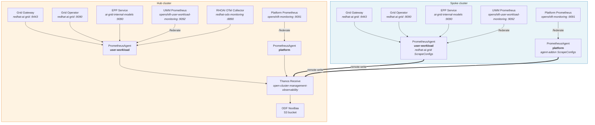
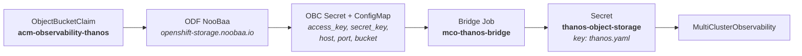

# Federated Metrics Aggregation

| Field   | Value |
|---------|-------|
| Status  | **Implemented** |
| Branch  | `feature/rhoai-3.6` |
| Date    | 2026-10-30 |

## Overview

RHOAI 3.6 ships Perses admin dashboards and ODC dashboards that consume
vLLM, EPP, GPU, and grid metrics via Thanos queries.  In a multi-cluster
fleet these metrics originate on spokes and must be federated to the hub.

**ACM MultiCluster Observability (MCO)** handles federation: it deploys
PrometheusAgent collectors on every managed cluster that scrape local
targets and remote-write to hub Thanos Receive.  We configure what gets
scraped via `ScrapeConfig` CRs deployed through ACM policies, and what
gets forwarded via a custom metrics allowlist ConfigMap.

There are three collection paths — user-workload metrics, platform
metrics, and hub-only RHOAI OTel metrics — all converging on the hub
Thanos store.

## Architecture



### Component inventory

| Component | Kind | Namespace | Clusters | Policy file |
|-----------|------|-----------|----------|-------------|
| ACM Operator | Subscription | `open-cluster-management` | hub | `16-acm-policy.yaml` |
| MultiClusterHub | MCH | `open-cluster-management` | hub | `16-acm-policy.yaml` |
| MultiClusterObservability | MCO | `open-cluster-management-observability` | hub | `16-acm-policy.yaml` |
| Thanos OBC `acm-observability-thanos` | OBC | `open-cluster-management-observability` | hub | `16-acm-policy.yaml` |
| Thanos bridge Job | Job | `open-cluster-management-observability` | hub | `16-acm-policy.yaml` |
| Custom allowlist ConfigMap | ConfigMap | `open-cluster-management-observability` | hub | `16-acm-policy.yaml` |
| ScrapeConfig `grid-metrics` | ScrapeConfig | `redhat-ai-grid` | all | `14-observability-policy.yaml` |
| ScrapeConfig `grid-operator-metrics` | ScrapeConfig | `redhat-ai-grid` | all | `14-observability-policy.yaml` |
| ScrapeConfig `epp-metrics` | ScrapeConfig | `redhat-ai-grid` | all | `14-observability-policy.yaml` |
| ScrapeConfig `uwm-federate-metrics` | ScrapeConfig | `redhat-ai-grid` | all | `14-observability-policy.yaml` |
| ScrapeConfig `gpu-platform-metrics` | ScrapeConfig | `open-cluster-management-agent-addon` | all | `14-observability-policy.yaml` |
| ScrapeConfig `rhai-metrics` | ScrapeConfig | `open-cluster-management-observability` | hub | `14-observability-policy.yaml` |
| EPP metrics reader SA + token | SA, Secret, CRB | `redhat-ai-grid` | all | `14-observability-policy.yaml` |
| UWM federate reader SA + token | SA, Secret, CRB | `redhat-ai-grid` | all | `14-observability-policy.yaml` |
| Grid gateway metrics Service | Service | `redhat-ai-grid` | all | `19-grid-gateway-policy.yaml` |
| User Workload Monitoring | ConfigMap | `openshift-monitoring` | all | `02-platform-config-policy.yaml` |

## Collection Paths

### Path 1: User Workload Metrics (all clusters)

Four ScrapeConfigs in `redhat-ai-grid` namespace, labeled
`app.kubernetes.io/component: user-workload-metrics-collector`, are
discovered by the MCO-deployed PrometheusAgent (user-workload variant).

| ScrapeConfig | Target | Port | Path | Interval | Auth |
|-------------|--------|------|------|----------|------|
| `grid-metrics` | `grid-gateway-metrics.redhat-ai-grid.svc` | 9443 | `/metrics` | 30s | HTTPS + service-CA TLS |
| `grid-operator-metrics` | `grid-operator-metrics.redhat-ai-grid.svc` | 9090 | `/metrics` | 30s | HTTPS + service-CA TLS |
| `epp-metrics` | `facebook-opt-125m-epp-service.ai-grid-internal-models.svc` | 9090 | `/metrics` | 30s | HTTP + bearer token |
| `uwm-federate-metrics` | `prometheus-user-workload.openshift-user-workload-monitoring.svc` | 9092 | `/federate` | 30s | HTTPS + bearer token + service-CA TLS |

The `uwm-federate-metrics` ScrapeConfig federates recording rules from
User Workload Monitoring Prometheus:

```yaml
params:
  match[]:
    - '{__name__=~"(vllm|kserve_vllm):.*"}'
    - '{__name__=~"llm_d_epp_.*|praxis_workload_status|http_requests_total"}'
```

The `grid-metrics` ScrapeConfig renames the `cluster` label to `backend`
to avoid collision with MCO's own `cluster` label:

```yaml
metricRelabelings:
  - sourceLabels: [cluster]
    regex: (.+)
    targetLabel: backend
    action: replace
```

### Path 2: Platform GPU Metrics (all clusters)

One ScrapeConfig in `open-cluster-management-agent-addon`, labeled
`app.kubernetes.io/component: platform-metrics-collector`, is discovered
by the MCO platform PrometheusAgent.

| ScrapeConfig | Target | Port | Path | Interval | Auth |
|-------------|--------|------|------|----------|------|
| `gpu-platform-metrics` | `prometheus-k8s.openshift-monitoring.svc` | 9091 | `/federate` | 60s | HTTPS (kube-rbac-proxy) |

This ScrapeConfig **must** be in `open-cluster-management-agent-addon`
because the platform PrometheusAgent has no `scrapeConfigNamespaceSelector`
and only discovers ScrapeConfigs in its own namespace.

Federates DCGM GPU metrics and RHOAI GPU recording rules:

```yaml
params:
  match[]:
    - '{__name__=~"DCGM_FI_DEV_GPU_UTIL|DCGM_FI_DEV_GPU_TEMP|DCGM_FI_DEV_FB_USED|DCGM_FI_DEV_FB_FREE"}'
    - '{__name__=~"accelerator_gpu_utilization|cluster:usage:consumption:rhods:gpu:.*"}'
```

### Path 3: Hub-only RHOAI OTel Metrics

One conditional ScrapeConfig in `open-cluster-management-observability`
(guarded by namespace lookup — deploys only on hub):

| ScrapeConfig | Target | Port | Path | Interval | Auth |
|-------------|--------|------|------|----------|------|
| `rhai-metrics` | `data-science-collector-monitoring.redhat-ods-monitoring.svc` | 8890 | `/metrics` | default | HTTP |

This scrapes the RHOAI data-science-collector OTel exporter's Prometheus
endpoint, which is only deployed when DSCI monitoring is Managed or the
OTel collector is deployed independently.

## MCO Configuration

```yaml
apiVersion: observability.open-cluster-management.io/v1beta2
kind: MultiClusterObservability
metadata:
  name: observability
  namespace: open-cluster-management-observability
spec:
  instanceSize: minimal
  observabilityAddonSpec:
    interval: 60
  storageConfig:
    metricObjectStorage:
      name: thanos-object-storage
      key: thanos.yaml
    compactStorageSize: 101Gi
  advanced:
    retentionConfig:
      retentionResolutionRaw: 7d
      retentionResolution5m: 14d
      retentionResolution1h: 14d
    receive:
      replicas: 2
  capabilities:
    platform:
      metrics:
        default:
          enabled: true
        ui:
          enabled: true
    userWorkloads:
      metrics:
        default:
          enabled: true
```

| Setting | Value | Notes |
|---------|-------|-------|
| Instance size | `minimal` | Smallest MCO footprint |
| Scrape interval | 60s | Global default for MCO agents |
| Raw retention | 7d | Full-resolution metrics |
| 5m retention | 14d | MCO minimum for compact retention |
| 1h retention | 14d | Long-term aggregates |
| Compact storage | 101Gi | Thanos compactor PVC |
| Receive replicas | 2 | HA for remote-write ingestion |
| Platform metrics | enabled (default + UI) | DCGM GPU, RHOAI recording rules |
| User workload metrics | enabled (default) | vLLM, EPP, grid metrics |

## Thanos OBC + Bridge Pattern

S3 storage for Thanos is provisioned via ODF NooBaa, using the same
OBC → bridge Job pattern as the LokiStack bucket
(see [federated-logging.md](federated-logging.md)):



The bridge Job renders a `thanos.yaml` config:

```yaml
type: s3
config:
  bucket: <from OBC ConfigMap>
  endpoint: <host>:<port>
  insecure: false
  access_key: <from OBC Secret>
  secret_key: <from OBC Secret>
  http_config:
    tls_config:
      ca_file: /var/run/secrets/kubernetes.io/serviceaccount/service-ca.crt
```

## Custom Metrics Allowlist

The ConfigMap `observability-metrics-custom-allowlist` in
`open-cluster-management-observability` extends the MCO default allowlist.

### Platform metrics (`metrics_list.yaml` — 11 metrics)

| Metric | Source |
|--------|--------|
| `DCGM_FI_DEV_GPU_UTIL` | NVIDIA DCGM exporter |
| `DCGM_FI_DEV_GPU_TEMP` | NVIDIA DCGM exporter |
| `DCGM_FI_DEV_FB_USED` | NVIDIA DCGM exporter |
| `DCGM_FI_DEV_FB_FREE` | NVIDIA DCGM exporter |
| `accelerator_gpu_utilization` | RHOAI recording rule |
| `cluster:usage:consumption:rhods:gpu:utilization:avg` | RHOAI recording rule |
| `cluster:usage:consumption:rhods:gpu:memory_utilization:avg` | RHOAI recording rule |
| `cluster:usage:consumption:rhods:gpu:temperature:max` | RHOAI recording rule |
| `cluster:usage:consumption:rhods:gpu:memory_used:sum` | RHOAI recording rule |
| `cluster:usage:consumption:rhods:gpu:power:sum` | RHOAI recording rule |
| `cluster:usage:consumption:rhods:gpu:count` | RHOAI recording rule |

### User workload metrics (`uwl_metrics_list.yaml` — 34 metrics)

| Category | Metrics |
|----------|---------|
| KServe vLLM (14) | `kserve_vllm:{num_requests_running, num_requests_waiting, request_success_total, generation_tokens_total, prompt_tokens_total, e2e_request_latency_seconds_bucket, time_to_first_token_seconds_bucket, time_per_output_token_seconds_bucket, prefix_cache_hits_total, prefix_cache_queries_total, kv_cache_usage_perc, request_prefill_time_seconds_bucket, request_decode_time_seconds_bucket, num_preemptions_total}` |
| EPP (10) | `llm_d_epp_{scheduler_e2e_duration_seconds_bucket, request_error_total, request_total, per_endpoint_queue_size, ready_endpoints, average_queue_size, request_running, request_slo_violation_total, flow_control_pool_saturation, average_kv_cache_utilization}` |
| vLLM legacy (8) | `vllm:{num_requests_running, num_requests_waiting, request_success_total, generation_tokens_total, prompt_tokens_total, e2e_request_latency_seconds_bucket, kv_cache_usage_perc, prompt_tokens_cached_total}` |
| Grid / HTTP (2) | `praxis_workload_status`, `http_requests_total` |

> **MCOA workaround**: MCOA (addon-manager) does not propagate the
> `observability-metrics-custom-allowlist` ConfigMap to spoke collectors
> via ManifestWork.  The architecture works around this by deploying
> ScrapeConfigs directly in `redhat-ai-grid` (all clusters), where the
> MCO user-workload PrometheusAgent discovers and scrapes them without
> relying on allowlist propagation.  The allowlist is maintained as a
> secondary mechanism for the hub.

## RBAC

### Metrics reader ServiceAccounts (all clusters — Policy 14)

| ServiceAccount | Namespace | Token Secret | ClusterRoleBinding | ClusterRole | Purpose |
|----------------|-----------|--------------|--------------------|----|---------|
| `grid-epp-metrics-reader` | `redhat-ai-grid` | `grid-epp-metrics-reader-token` | `grid-epp-metrics-reader` | `kserve-metrics-reader-cluster-role` | Bearer auth for `epp-metrics` ScrapeConfig |
| `grid-uwm-federate-reader` | `redhat-ai-grid` | `grid-uwm-federate-reader-token` | `grid-uwm-federate-reader` | `cluster-monitoring-view` | Bearer auth for `uwm-federate-metrics` ScrapeConfig |

### Thanos bridge RBAC (hub only — Policy 16)

| ServiceAccount | Namespace | Role | Permissions |
|----------------|-----------|------|-------------|
| `mco-thanos-bridge` | `open-cluster-management-observability` | `mco-thanos-bridge` | OBCs (get/list/watch), ObjectBuckets (get/list), Secrets (CRUD), ConfigMaps (get/list) |

## NetworkPolicies

| NetworkPolicy | Namespace | Pod Selector | From Namespace | Ports | Policy |
|---------------|-----------|-------------|----------------|-------|--------|
| `allow-acm-rhai-metrics` | `redhat-ods-monitoring` | OTel collector pods | `open-cluster-management-agent-addon` | 8890/TCP | `14-observability-policy.yaml` |
| `allow-acm-grid-metrics` | `redhat-ai-grid` | all pods | `open-cluster-management-agent-addon` | 9443/TCP, 9090/TCP | `14-observability-policy.yaml` |
| `allow-acm-pool-metrics` | `ai-grid-internal-models` | all pods | `open-cluster-management-agent-addon` | 9090/TCP, 8000/TCP | `14-observability-policy.yaml` |
| `grid-operator-metrics-scraping` | `ai-grid-internal-models` | — | `redhat-ai-grid` | 9090/TCP | `11-grid-network-policies-policy.yaml` |

## Policy Files

| File | Placement | Metrics ConfigurationPolicies |
|------|-----------|-------------------------------|
| `hub/platform/16-acm-policy.yaml` | hub-only | `osac-acm-ns`, `osac-acm-subscription`, `osac-acm-multiclusterhub`, `osac-acm-observability-ns`, `osac-acm-thanos-obc`, `osac-acm-thanos-bridge-rbac`, `osac-acm-thanos-bridge-job`, `osac-acm-multiclusterobservability`, `osac-acm-custom-allowlist` |
| `hub/platform/14-observability-policy.yaml` | all clusters | `osac-observability-rbac`, `osac-observability-scrapeconfigs`, `osac-observability-scrapeconfigs-acm`, `osac-observability-network-policy` |
| `hub/platform/02-platform-config-policy.yaml` | all clusters | Enables User Workload Monitoring (`enableUserWorkload: true`) |
| `hub/platform/19-grid-gateway-policy.yaml` | all clusters | Grid gateway metrics Service (port 9443, serving-cert TLS) |
| `hub/platform/11-grid-network-policies-policy.yaml` | all clusters | Grid operator metrics scraping NetworkPolicy |

## Key Architectural Decisions

1. **MCOA custom-allowlist workaround** — MCOA does not propagate the
   `observability-metrics-custom-allowlist` ConfigMap to spoke collectors
   via ManifestWork.  All ScrapeConfigs are deployed directly in
   `redhat-ai-grid` on every cluster so MCO PrometheusAgents discover
   and scrape them without needing the allowlist.

2. **GPU metrics namespace** — The `gpu-platform-metrics` ScrapeConfig
   lives in `open-cluster-management-agent-addon`, not `redhat-ai-grid`,
   because the platform PrometheusAgent has no
   `scrapeConfigNamespaceSelector` and only discovers ScrapeConfigs in
   its own namespace.

3. **Platform Prometheus scheme** — Port 9091 on `prometheus-k8s` sits
   behind kube-rbac-proxy, requiring `scheme: HTTPS`.  Auth and TLS CA
   come from the PrometheusAgent's default endpoint configuration.

4. **Thanos compact retention** — The 5m-resolution retention is set to
   14d (not 7d) to satisfy MCO's minimum threshold for compact retention.

5. **cluster → backend relabel** — The `grid-metrics` ScrapeConfig
   renames the `cluster` label to `backend` to avoid collision with
   MCO's own `cluster` label that identifies the source cluster.

## Verification

### MCO health

```bash
oc get multiclusterobservability observability \
  -o jsonpath='{.status.conditions[?(@.type=="Ready")].status}' \
  --context=$HUB_CTX
# Expected: True
```

### ScrapeConfig targets

```bash
# All clusters
oc get scrapeconfigs -n redhat-ai-grid --context=$HUB_CTX
oc get scrapeconfigs -n redhat-ai-grid --context=$SPOKE_CTX

# Platform (all clusters)
oc get scrapeconfigs -n open-cluster-management-agent-addon --context=$HUB_CTX
oc get scrapeconfigs -n open-cluster-management-agent-addon --context=$SPOKE_CTX

# Hub-only
oc get scrapeconfigs -n open-cluster-management-observability --context=$HUB_CTX
```

### Thanos query (via hub Thanos querier)

```bash
THANOS_ROUTE=$(oc get route rbac-query-proxy \
  -n open-cluster-management-observability --context=$HUB_CTX \
  -o jsonpath='{.status.ingress[0].host}')
TOKEN=$(oc whoami -t --context=$HUB_CTX)

# vLLM request rate
curl -sk -H "Authorization: Bearer $TOKEN" \
  "https://${THANOS_ROUTE}/api/v1/query" \
  --data-urlencode 'query=kserve_vllm:request_success_total'

# GPU utilization
curl -sk -H "Authorization: Bearer $TOKEN" \
  "https://${THANOS_ROUTE}/api/v1/query" \
  --data-urlencode 'query=DCGM_FI_DEV_GPU_UTIL'

# EPP queue size
curl -sk -H "Authorization: Bearer $TOKEN" \
  "https://${THANOS_ROUTE}/api/v1/query" \
  --data-urlencode 'query=llm_d_epp_average_queue_size'
```

### ACM policy compliance

```bash
oc get policy -n osac-platform --context=$HUB_CTX \
  | grep -E 'osac-acm|osac-observability'
```
